# Traffic Stop Intersection

ENCE 2101 Digital Design – Final Project<br>
University of Denver, Fall 2026<br>
Ethan Bruley

Simulation demo: [demo/simulation_demo.mp4](demo/simulation_demo.mp4)


DE10-Lite demo: [board video (Google Drive)](https://drive.google.com/file/d/1lln-BvomPKYAPFw585PGFvVw0Iw1YGRI/view)

## 1. Introduction

This project implements a traffic light controller for a two-road intersection, with a pedestrian crossing button. The circuit was designed in Logisim Evolution and targeted to the DE10-Lite FPGA board. Two traffic lights, A (east–west) and B (north–south), take turns. Each green and yellow lasts 3 seconds. When a pedestrian button is pressed, both lights turn red for a 10-second walk once the current road has finished its yellow. A two-digit display counts down the time remaining in each phase.

The design is made up of four main parts:

1. A six-state Moore finite state machine (FSM) that controls the sequence.
2. A 4-bit counter that times each phase.
3. A latch that stores pedestrian button presses.
4. Combinational logic for the lights and the countdown display.

Table 1 lists the requirements from the assignment and how the design meets each one.

<p align="center">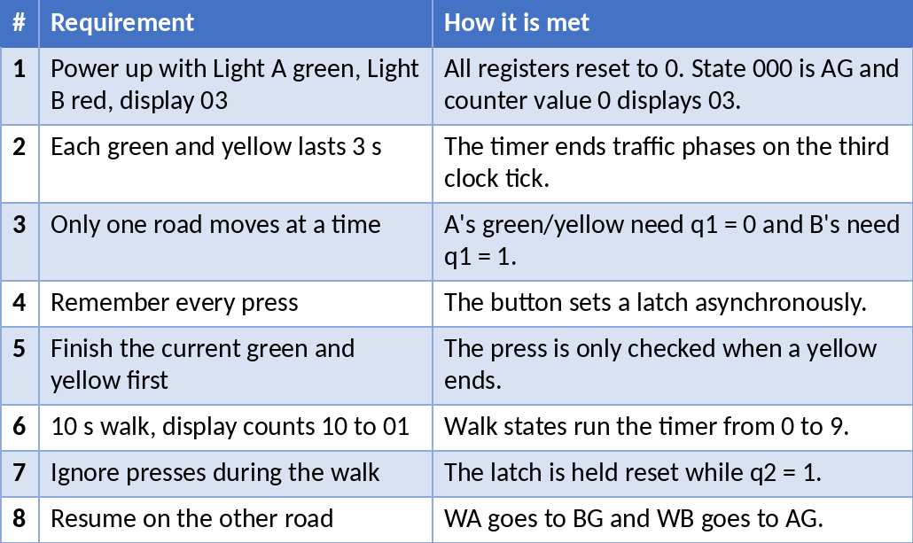</p>
<p align="center"><i>Table 1. Project requirements</i></p>

## 2. Repository Contents

```
ENCE-2101-Traffic-Intersection-Final/
├── README.md                    project report
├── traffic_intersection.circ    Logisim Evolution project file
├── demo/simulation_demo.mp4     recording of the Logisim simulation
└── images/                      circuit screenshots, tables and handwritten notes
```


## 3. System Overview

The circuit was split into subcircuits so that each part could be built and tested on its own. The `fsm` subcircuit contains the state register and the timer. The other subcircuits either provide inputs to the FSM or decode its outputs. Figure 1 shows how the blocks connect, and Table 2 lists each subcircuit's inputs and outputs.

<p align="center">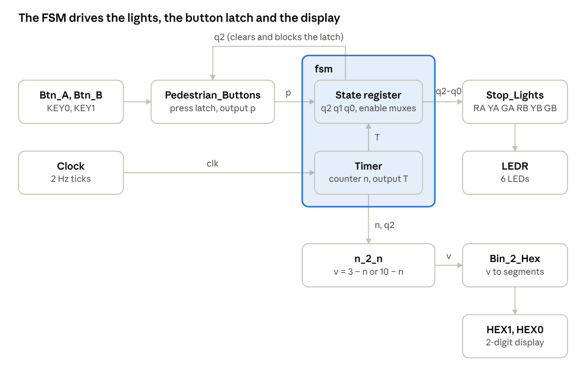</p>
<p align="center"><i>Figure 1. Block diagram of the system</i></p>

<p align="center">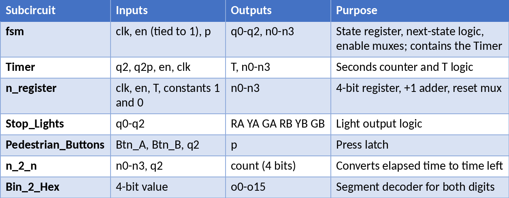</p>
<p align="center"><i>Table 2. Subcircuits</i></p>

<p align="center">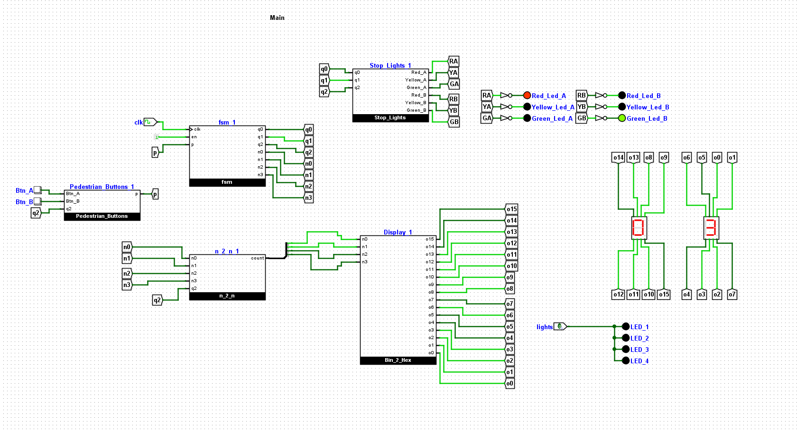</p>
<p align="center"><i>Figure 2. Main circuit in Logisim</i></p>

## 4. FSM Design

### 4.1 States

The controller was designed as a Moore machine. The lights depend only on the current state, so the light logic does not need the inputs at all. The FSM has two inputs. T comes from the timer and is 1 during the last second of a phase. p comes from the button latch and is 1 when a walk has been requested.

Six states are needed. There are four traffic states (A green, A yellow, B green, B yellow) and two walk states. Two walk states were used instead of one because after a walk, the road that did not just move has to go next. WA always comes after A's yellow and is followed by B green, and WB always comes after B's yellow and is followed by A green. With a single walk state, an extra flip-flop would have been needed to remember which road had gone last.

Six states require three flip-flops (q2 q1 q0). The encoding in Table 3 was chosen for three reasons:

- AG is 000. Logisim registers reset to 0, so the circuit starts in the correct state at power-up.
- Each bit has a meaning. q2 = 1 means a walk, q1 selects the road (0 for A, 1 for B), and q0 selects green (0) or yellow (1). This keeps the light logic simple, and lets the timer and the latch use q2 directly.
- The unused codes 110 and 111 go back to AG and show red on both roads, so the circuit would recover if it ever reached one of them.

<p align="center">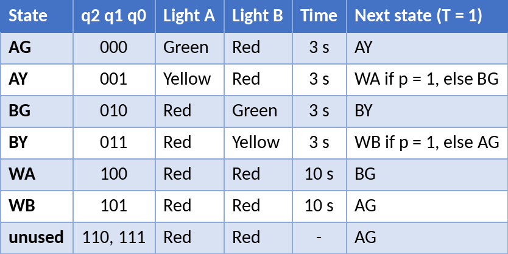</p>
<p align="center"><i>Table 3. State assignment</i></p>

The handwritten version of this table is in Appendix A (Figure A1).

<p align="center">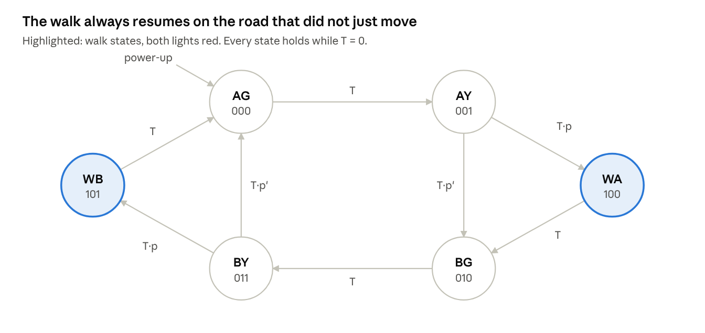</p>
<p align="center"><i>Figure 3. State diagram (each state holds while T = 0)</i></p>

### 4.2 Next-State Logic

The state only changes when T = 1. That condition is handled by an enable mux on each flip-flop (Section 4.3), so the next-state table only needs to describe what happens at the end of a phase. That leaves four inputs (q2, q1, q0, p) and 16 rows instead of 32. The table is shown in Table 4, and the handwritten version is in Figure A2.

<p align="center">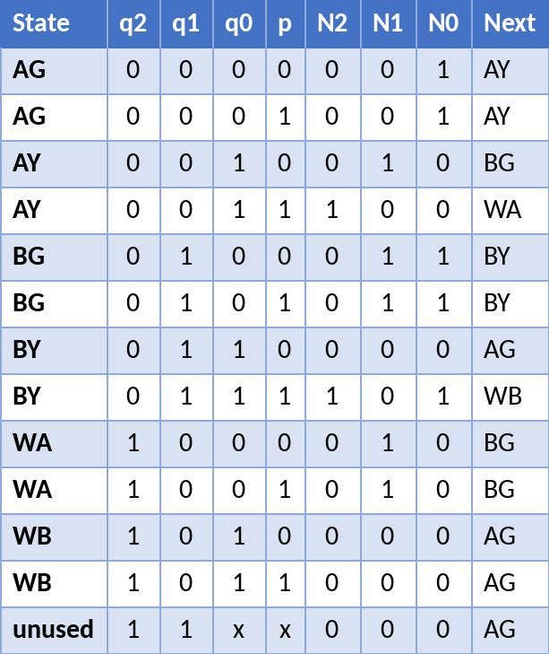</p>
<p align="center"><i>Table 4. Next-state table (applies when T = 1)</i></p>

A K-map was made for each next-state bit. The K-maps are shown in Figures 4 to 6, with rows q2q1 and columns q0p in Gray-code order.

<p align="center">
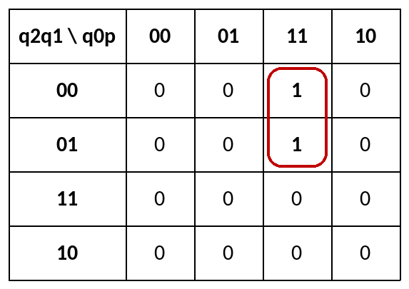
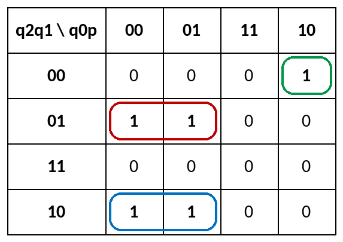
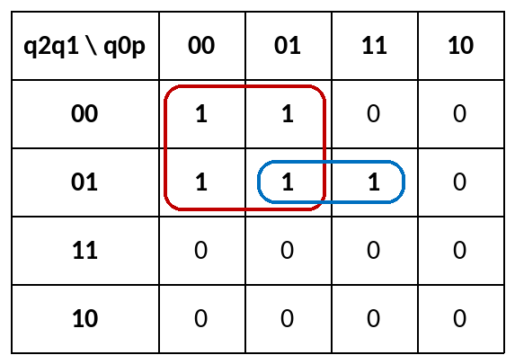
</p>
<p align="center"><i>Figures 4–6. K-maps for N2, N1 and N0 (handwritten version: Figure A3)</i></p>

For N2, the only two 1s form a vertical pair, so q1 drops out. This gives q2'·q0·p, which is true only in a yellow state with a press stored.

N1 has three groups. The pair in row 01 is BG going to BY, the pair in row 10 is WA going to BG, and the single cell 0010 is AY going to BG with no press.

N0 has a quad covering both green states, where any green moves to its yellow. It also has a pair for BY going to WB, which overlaps the quad at cell 0101.

The resulting equations are:

D2 = q2'·q0·p<br>
D1 = q2'·q1·q0' + q2·q1'·q0' + q2'·q1'·q0·p'<br>
D0 = q2'·q0' + q2'·q1·p

### 4.3 Flip-Flops and Enable

D flip-flops were used for the state register. With D flip-flops, each next-state equation connects directly to a D input. JK or T flip-flops would have required an excitation table and more K-maps. The FPGA on the DE10-Lite is also built from D-type registers.

The D flip-flops in Logisim Evolution have no enable input. Instead, each D input is driven by a 2:1 multiplexer with T as the select line. When T = 0, the mux feeds the flip-flop's own output back, so the state holds. When T = 1, it passes the next-state value. Gating the clock with T would also have worked, but it can cause glitches and is poor practice on an FPGA.

<p align="center">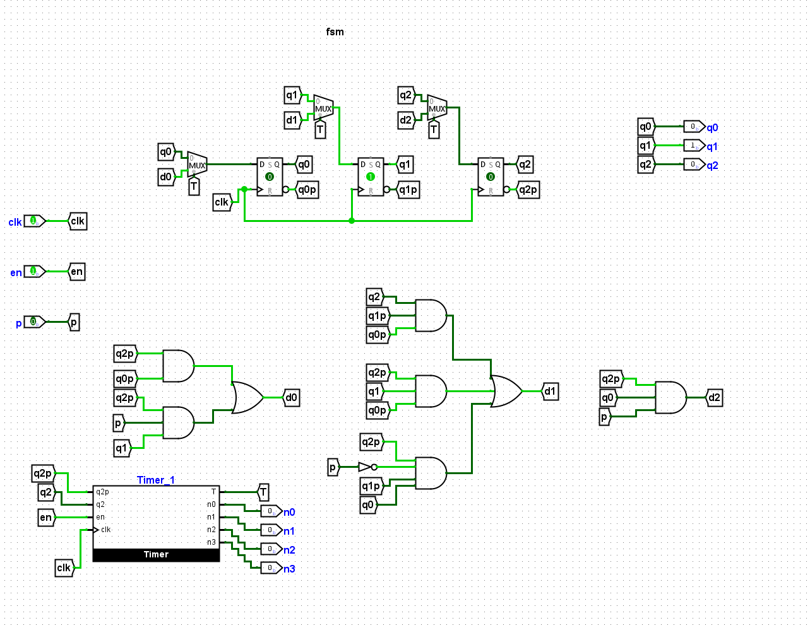</p>
<p align="center"><i>Figure 7. fsm subcircuit</i></p>

## 5. Timer

The timer is a 4-bit counter, n, that counts the seconds elapsed in the current phase. It is built in the `n_register` subcircuit from three parts:

- A 4-bit register.
- An adder that computes n + 1.
- A 2:1 mux that selects n + 1 when T = 0, or 0 when T = 1.

The register's write enable is tied to 1, and it shares the clock with the FSM. On a tick where T = 1, the FSM moves to its next state and the counter resets to 0 on the same clock edge.

Four bits were needed because the walk requires the counter to reach 9. The counter counts elapsed time upward instead of counting down, because the registers reset to 0. With this choice, n = 0 at power-up is already the first second of AG, and the display shows 03 without any extra preset logic.

The counter's built-in asynchronous clear was not used. It would reset n as soon as T went high, which would make T drop back to 0 before the FSM could see it on the clock edge.

<p align="center">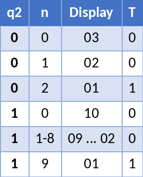</p>
<p align="center"><i>Table 5. Timer behavior (handwritten version: Figure A6)</i></p>

As shown in Table 5, T must be 1 when n = 2 in a traffic phase and when n = 9 in a walk:

T = q2'·(n = 2) + q2·(n = 9)

This simplifies because n never goes past the end of its phase. In a traffic phase, n only takes the values 0, 1 and 2, and only 2 has n1 = 1. In a walk, n only takes the values 0 through 9, and only 9 has both n3 and n0 equal to 1. The values 10 through 15 never occur, so they were treated as don't-cares. The final equation is:

T = q2'·n1 + q2·n3·n0

<p align="center">
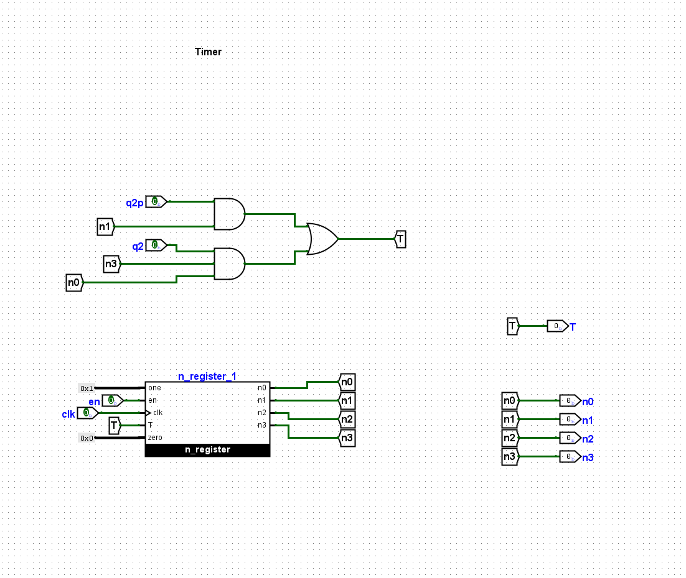
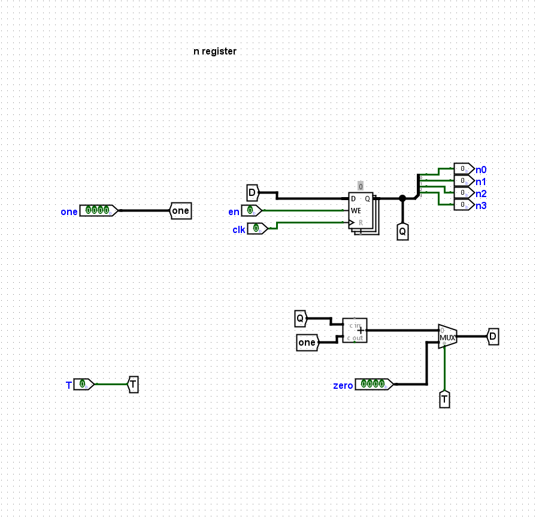
</p>
<p align="center"><i>Figure 8. Timer and n_register subcircuits</i></p>

## 6. Light Outputs

The `Stop_Lights` subcircuit converts the state into the six light signals using combinational logic only. The truth table is given in Table 6, and the handwritten version is in Figure A4.

<p align="center">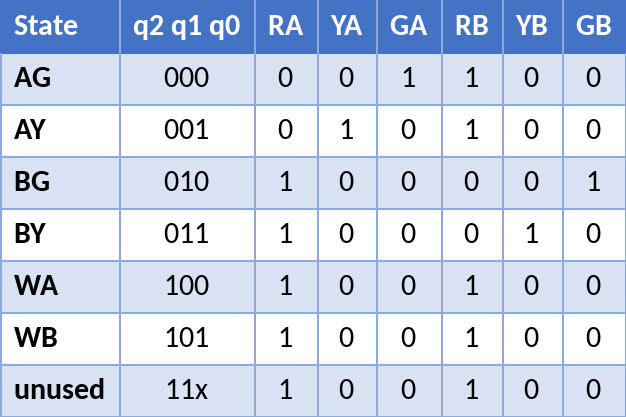</p>
<p align="center"><i>Table 6. Light outputs for each state</i></p>

Each green and yellow output is 1 in exactly one state, so each is a single AND of the three state bits. The two reds are on in most states and simplify to OR gates, as shown in the K-maps in Figures 9 and 10.

<p align="center">
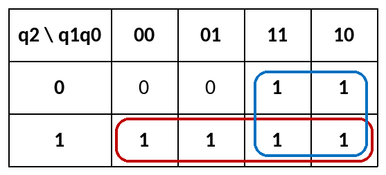
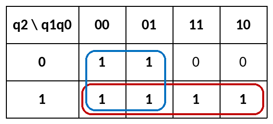
</p>
<p align="center"><i>Figures 9–10. K-maps for RA and RB (all six light K-maps, handwritten: Figure A5)</i></p>

GA = q2'·q1'·q0'<br>
YA = q2'·q1'·q0<br>
GB = q2'·q1·q0'<br>
YB = q2'·q1·q0<br>
RA = q2 + q1<br>
RB = q2 + q1'

This encoding also guarantees that the two roads can never be green or yellow at the same time. Light A's green and yellow both require q1 = 0, while Light B's require q1 = 1. In the unused states, q2 = 1 turns on both reds and blocks every green and yellow.

<p align="center">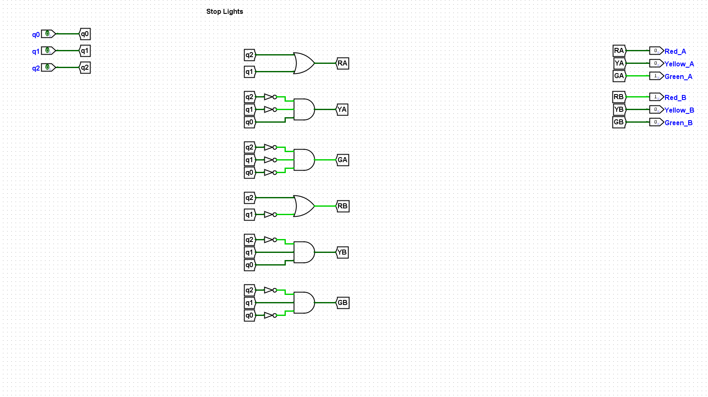</p>
<p align="center"><i>Figure 11. Stop_Lights subcircuit</i></p>

## 7. Pedestrian Button Latch

A press has to be remembered even when the button is released before the next clock edge. The clock only ticks once per second, so a clocked input could miss a short press. For this reason, the press is stored using the asynchronous set (S) and reset (R) pins of a D flip-flop, which act as an SR latch. The flip-flop's D and clock inputs are tied to 0. The set and reset logic is:

Set = (Btn_A + Btn_B)·q2'<br>
Reset = q2

The latch output p goes to 1 as soon as either button is pressed. It stays at 1 until the walk begins. When the walk begins, q2 becomes 1 and resets the latch, and the latch stays reset for the rest of the walk. Gating Set with q2' means that presses during the walk are ignored. It also means that S and R can never both be 1. Table 7 summarizes the latch behavior.

A latch built from cross-coupled NOR gates was also considered. It was not used because it can start in an unknown state in Logisim, and FPGA tools warn about combinational loops.

<p align="center">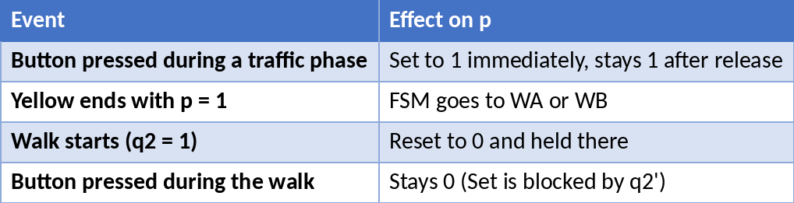</p>
<p align="center"><i>Table 7. Latch behavior</i></p>

<p align="center">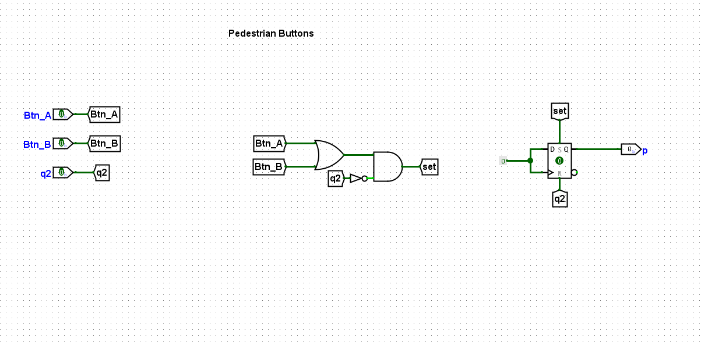</p>
<p align="center"><i>Figure 12. Pedestrian_Buttons subcircuit</i></p>

## 8. Countdown Display

The counter n counts up from 0, but the display must count down. A converter subcircuit (`n_2_n`) computes the time remaining, v. In traffic phases v = 3 − n, and in the walk v = 10 − n. A ROM was not allowed, so both values are built from logic gates, and a 4-bit mux controlled by q2 selects between them.

The traffic value, shown in Table 8, only needs two inverters: v = {0, 0, n1', n0'}.

The walk value, shown in Table 9, was found with a K-map for each bit, using 10 through 15 as don't-cares:

v0 = n0<br>
v1 = n1'·n0' + n1·n0<br>
v2 = n2·n1' + n2·n0' + n2'·n1·n0<br>
v3 = n3'·n2'·n1' + n2'·n1·n0'

<p align="center">
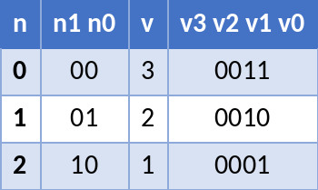
&nbsp;&nbsp;&nbsp;&nbsp;
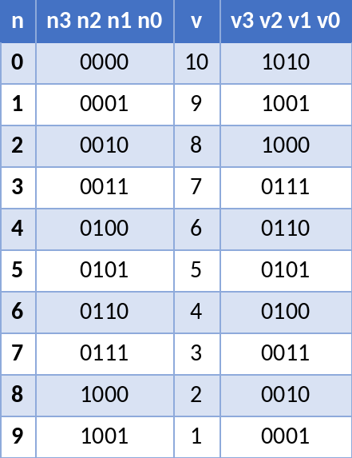
</p>
<p align="center"><i>Table 8. Traffic countdown &nbsp;&nbsp;&nbsp; Table 9. Walk countdown (handwritten K-maps: Figure A7)</i></p>

<p align="center">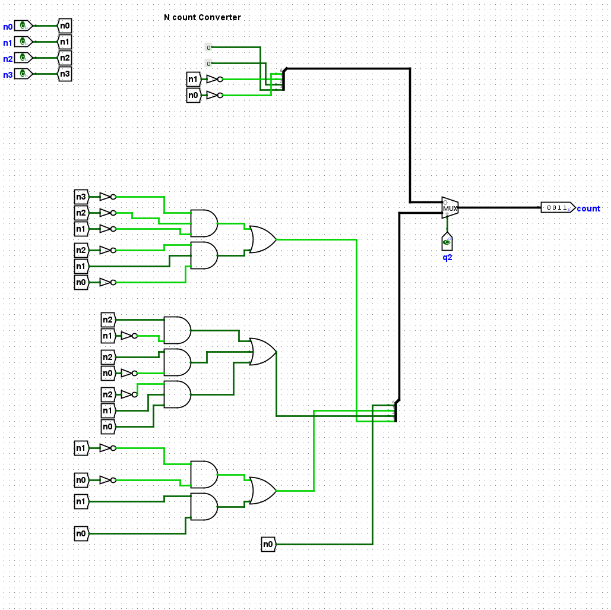</p>
<p align="center"><i>Figure 13. Countdown converter (n_2_n)</i></p>

The value v is then decoded by the `Bin_2_Hex` subcircuit, which drives the segments of both seven-segment digits. Outputs o0–o7 drive the ones digit and o8–o15 drive the tens digit. Each digit's segments are numbered 0 through 7 as listed in Table 10, and the full truth table is given in Table 11. Inputs 11 through 15 never occur, so they were treated as don't-cares in the K-maps.

<p align="center">
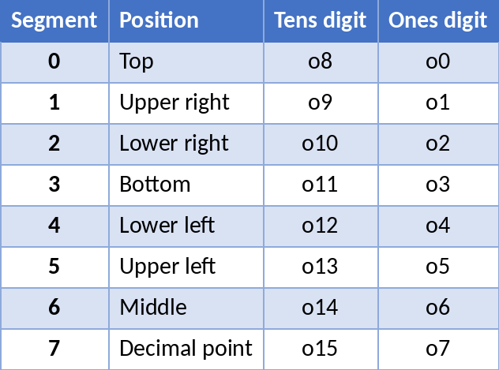
&nbsp;&nbsp;&nbsp;&nbsp;
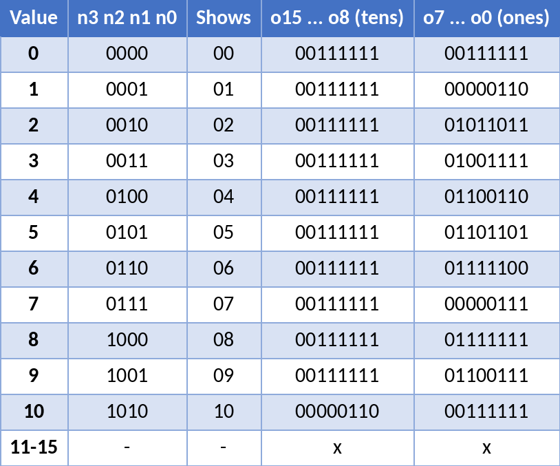
</p>
<p align="center"><i>Table 10. Segment numbering &nbsp;&nbsp;&nbsp; Table 11. Bin_2_Hex truth table (1 = segment on)</i></p>

The display only shows 01 through 10, so the tens digit only ever shows 0 or 1. Segments 1 and 2 (o9 and o10) are used by both digits, so they are tied to 1. The middle segment (o14) and the decimal point (o15) are tied to 0. The other four segments (o8, o11, o12 and o13) are only on when the tens digit shows 0. From the K-map, they simplify to:

o8 = o11 = o12 = o13 = n3' + n1'

The ones-digit decimal point (o7) is always 0. The remaining ones-digit segments came from one K-map each:

o0 = n3 + n2·n0 + n2'·n1 + n2'·n1'·n0'<br>
o1 = n2' + n3 + n1'·n0' + n1·n0<br>
o2 = n1' + n0 + n2 + n3<br>
o3 = n1·n0' + n2'·n1 + n2'·n1'·n0' + n2·n1'·n0<br>
o4 = n1·n0' + n2'·n1'·n0'<br>
o5 = n3 + n1'·n0' + n2·n1' + n2·n0'<br>
o6 = n3·n1' + n2·n1' + n3'·n2'·n1 + n3'·n1·n0'

The handwritten truth table and K-maps for this decoder are in Appendix A (Figures A8 and A9).

<p align="center">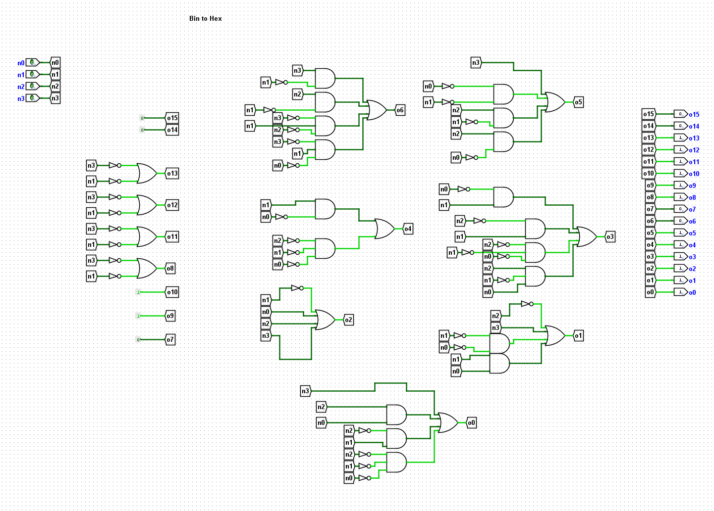</p>
<p align="center"><i>Figure 14. Bin_2_Hex decoder</i></p>

## 9. Hardware Implementation

The design was mapped to the DE10-Lite using the FPGA tool in Logisim Evolution, with the clock frequency set to 2 Hz. The Logisim Clock component is high for one tick and low for one tick, so 2 Hz gives one full clock cycle, and one count, per second. The pin assignments are listed in Table 12, and a video of the design running on the board is linked [here](https://drive.google.com/file/d/1lln-BvomPKYAPFw585PGFvVw0Iw1YGRI/view). All of the LEDR lights on the board are red, so each light's color is indicated by its position. Light A uses LEDR0 to LEDR2 and Light B uses LEDR7 to LEDR9, with green on the lowest number and red on the highest.

When the design was first run on the board, the LEDR outputs lit inverted compared with the simulation. To correct this, a NOT gate was placed in front of each of the six light LEDs in the main circuit. The LED colors in Logisim were also swapped (on color black, off color red, yellow or green), so the simulation still shows each light correctly while the board LEDs light the right way.

The LEDs between the two traffic lights (LEDR3 to LEDR6) are not used by the controller, but they stay lit on the board when nothing is mapped to them. To keep them off, four extra LEDs (LED_1 to LED_4) are mapped to those positions and driven by the `lights` input on SW9.

<p align="center">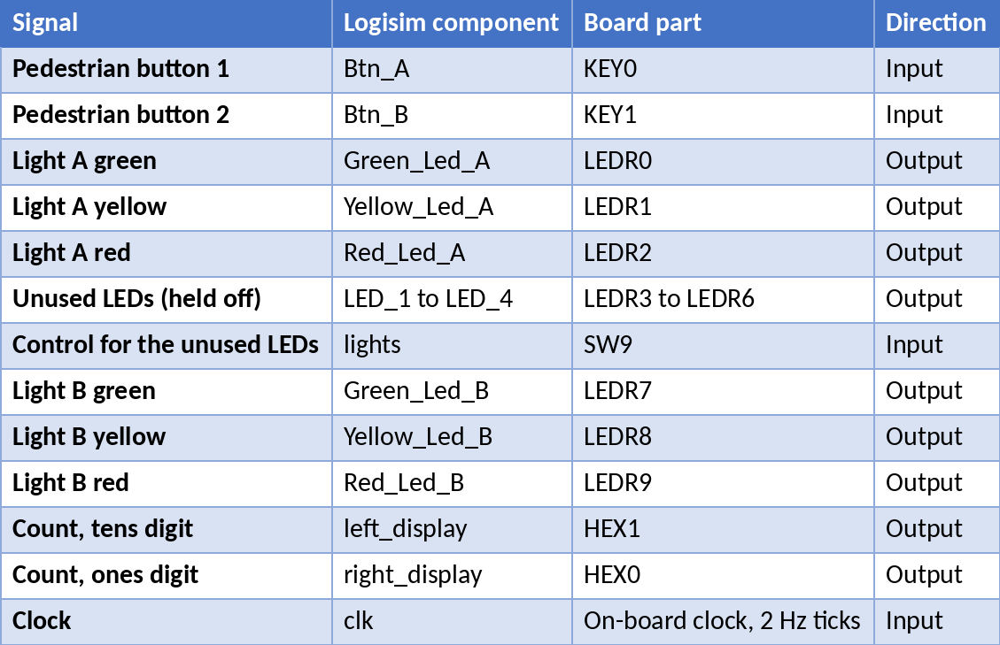</p>
<p align="center"><i>Table 12. DE10-Lite mapping</i></p>


## 10. Testing

The circuit was tested in Logisim by stepping the clock one tick at a time and comparing the results against the timing diagram from the assignment. Table 13 traces that scenario: one full cycle runs with no request, then a pedestrian presses a button at 13 s, while Light A is green. Light A still finishes its green and yellow. The walk runs from 18 s to 28 s, and traffic then resumes with Light B. The remaining test cases are listed in Table 14.

<p align="center">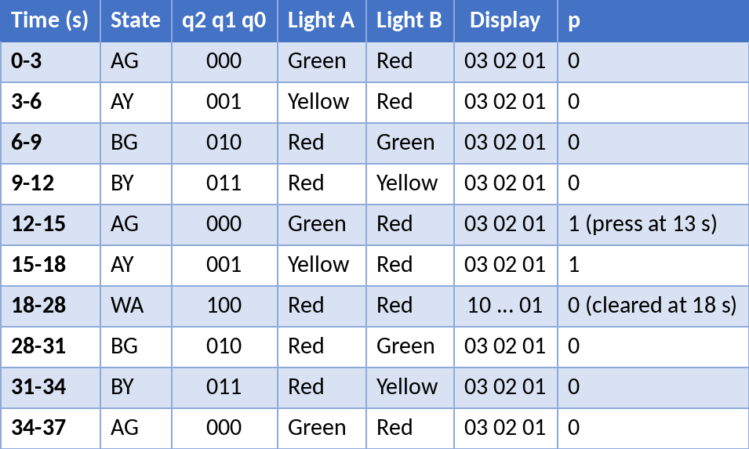</p>
<p align="center"><i>Table 13. Trace of the reference timing diagram</i></p>

The simulation was also recorded with the tick frequency set to 2 Hz, which gives one clock cycle per second (see `demo/simulation_demo.mp4`). The recording starts from a reset with Light A green and the display at 03. In the recording:

- Each display step lasts 1 s.
- Each green and yellow lasts 3 s.
- Both walks last 10 s, counting down from 10 to 01.
- The first request was made while Light A had the right of way. Its walk ran from 0:17 to 0:27 and was followed by Light B green.
- The second request was made while Light B had the right of way. Its walk ran from 0:33 to 0:43 and was followed by Light A green.

In both cases the walk began only after the current yellow had finished. The full set of test cases is listed in Table 14.

<p align="center">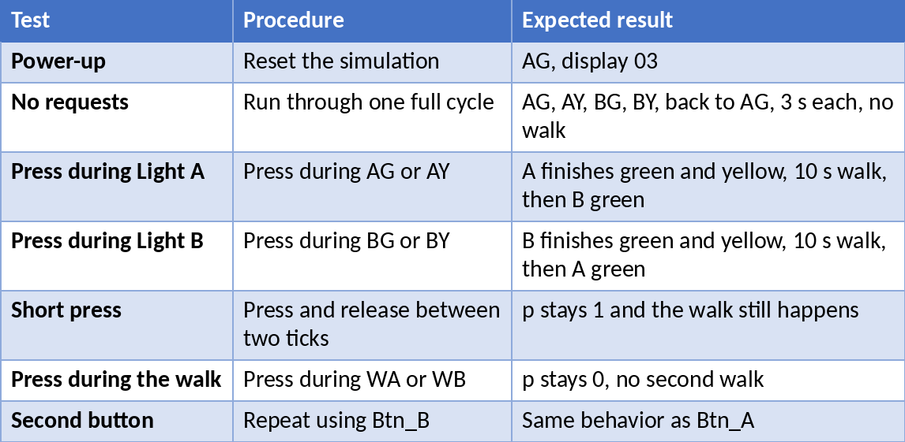</p>
<p align="center"><i>Table 14. Test cases</i></p>


## 11. Conclusion

The final design meets all eight requirements, using three state flip-flops, a 4-bit counter and a single latch. Most of the logic was kept small by choosing the state encoding carefully: each bit of the state has its own meaning, so the light outputs, the timer and the latch can each use the state bits directly. The main design decisions are summarized in Table 15.

<p align="center">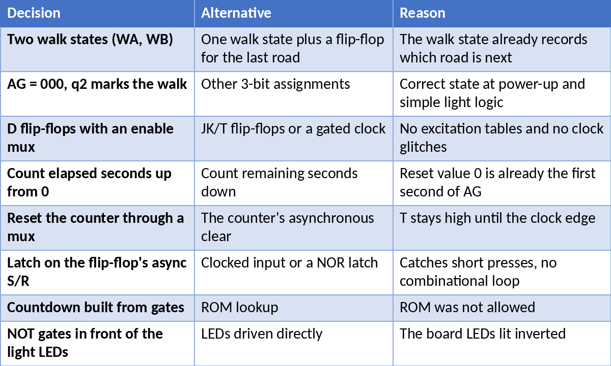</p>
<p align="center"><i>Table 15. Summary of design decisions</i></p>

## Appendix A. Handwritten Work

These are the original hand-drawn tables and K-maps that the design was worked out on. The notes use s2 s1 s0 for the state bits (q2 q1 q0 in the circuit). The countdown page uses a2 for q2 and f3–f0 for the converter outputs (v3–v0 in this report).

<p align="center">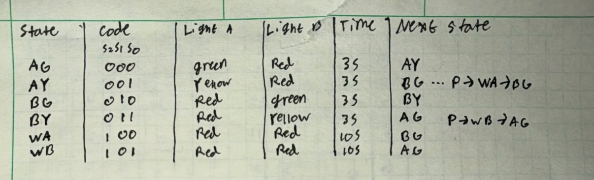</p>
<p align="center"><i>Figure A1. State assignment</i></p>

<p align="center">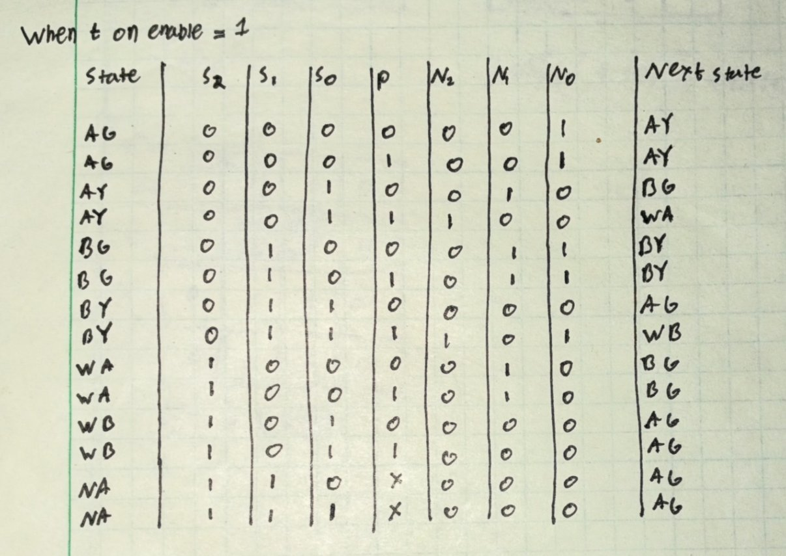</p>
<p align="center"><i>Figure A2. Next-state table (T = 1)</i></p>

<p align="center">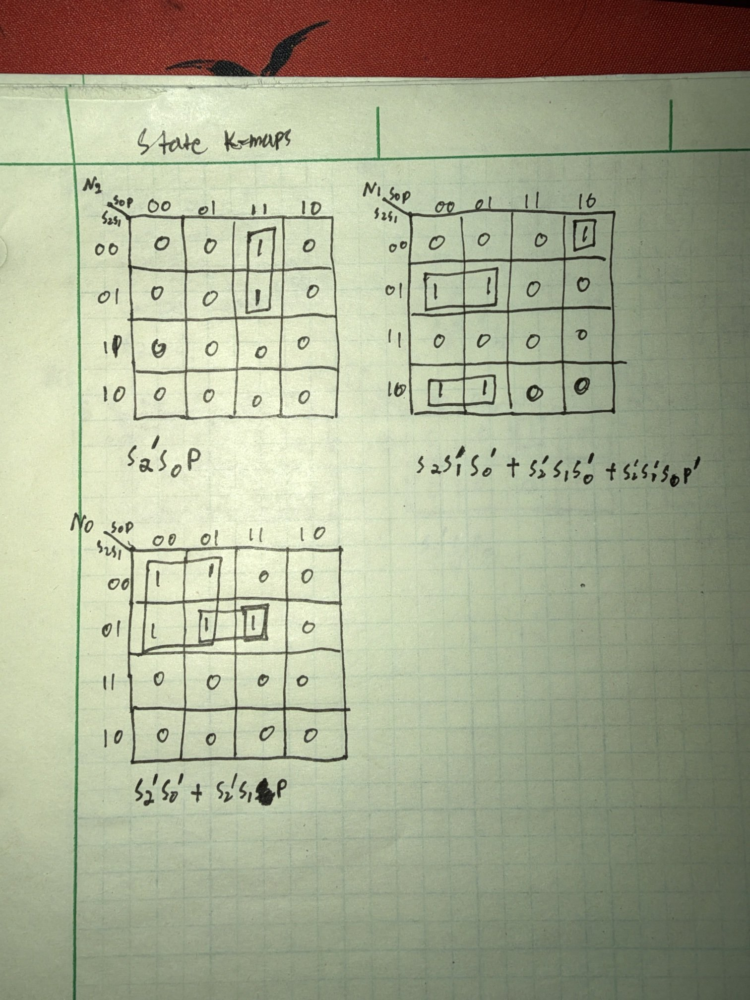</p>
<p align="center"><i>Figure A3. Next-state K-maps (N2, N1, N0)</i></p>

<p align="center">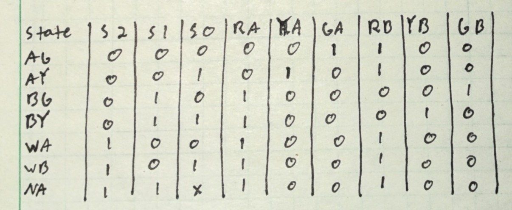</p>
<p align="center"><i>Figure A4. Light output table</i></p>

<p align="center">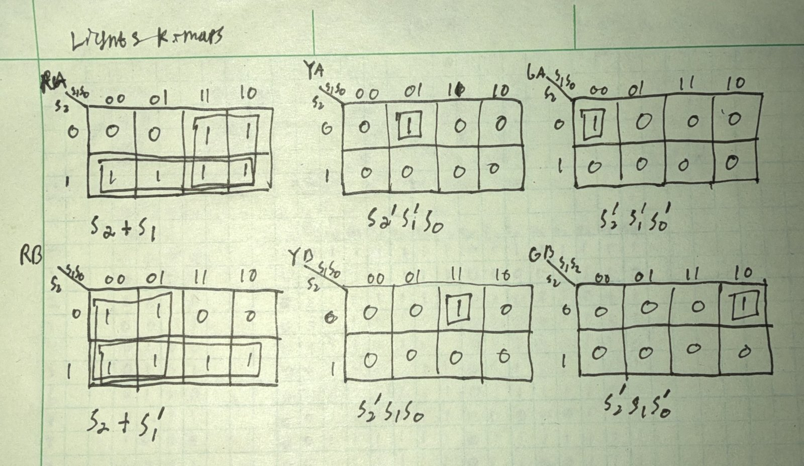</p>
<p align="center"><i>Figure A5. Light output K-maps</i></p>

<p align="center">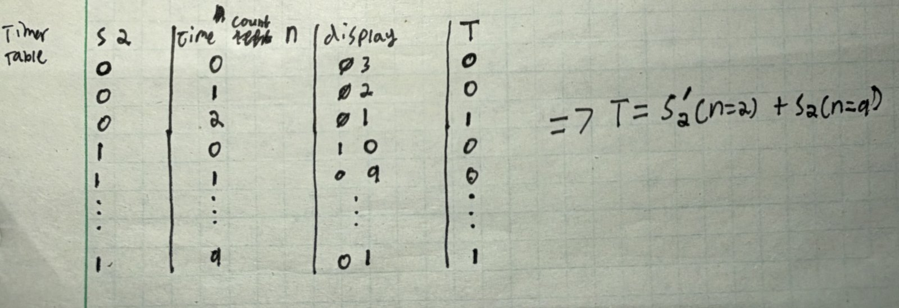</p>
<p align="center"><i>Figure A6. Timer table</i></p>

<p align="center">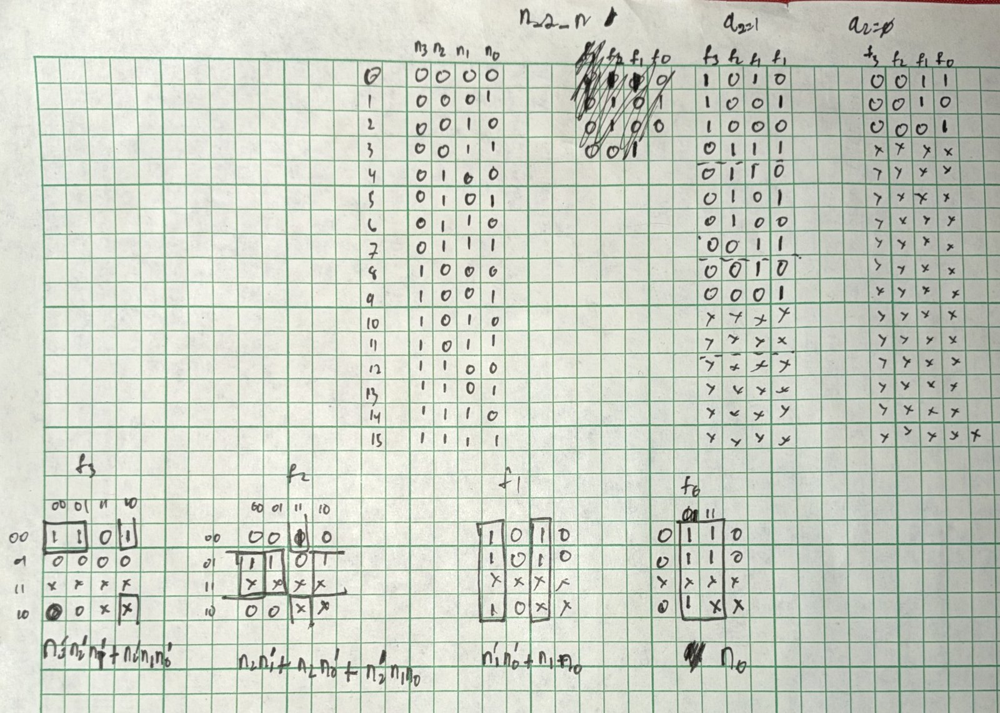</p>
<p align="center"><i>Figure A7. Countdown converter (n_2_n) truth table and K-maps</i></p>

<p align="center">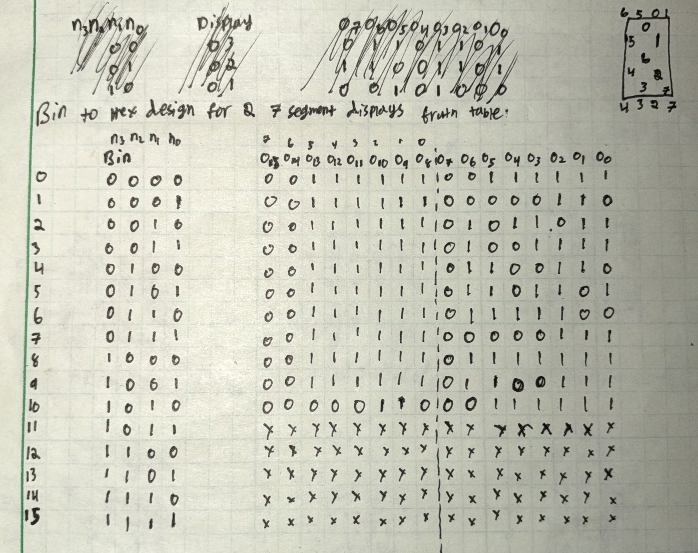</p>
<p align="center"><i>Figure A8. Bin_2_Hex truth table and segment numbering</i></p>

<p align="center">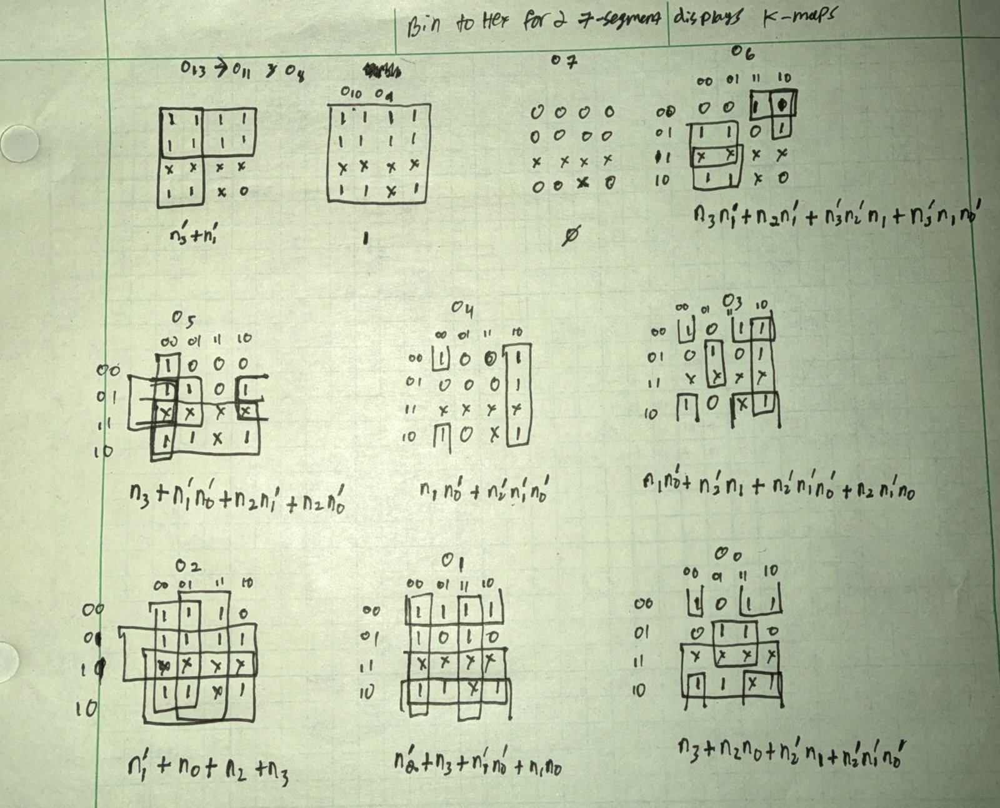</p>
<p align="center"><i>Figure A9. Bin_2_Hex K-maps</i></p>

## How to Run

1. Open `traffic_intersection.circ` in Logisim Evolution.
2. To simulate, choose Simulate → Reset Simulation, then step the clock with Simulate → Tick Once (Ctrl+T). Click Btn_A or Btn_B to request a walk.
3. To run on the DE10-Lite, open the FPGA tool, select the DE10-Lite board, map the components as in Table 12, set the clock frequency to 2 Hz, and download.
